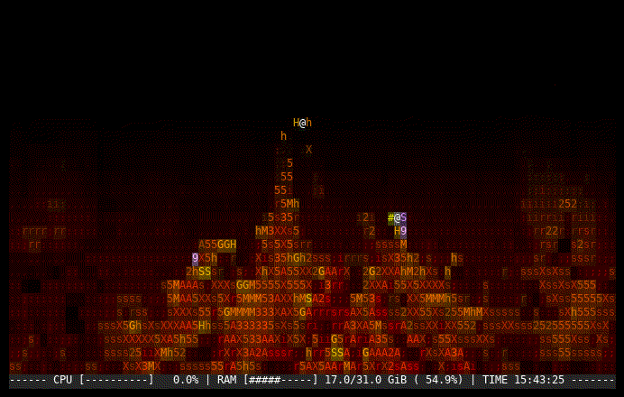

# firec

A cozy, full-screen ASCII fireplace for Linux terminals, written in C.



The animation is embedded in the executable, so playback does not need a
video file, Python, or FFmpeg. The last terminal row shows live CPU usage,
memory usage, and the local time.

## Requirements

- Linux with `/proc/stat` and `/proc/meminfo`
- A terminal with 24-bit color support
- A C11 compiler and `make`

## Build and run

```sh
make
./fire
```

Press `Ctrl+C` to stop. The scene automatically adapts to terminal resizing.

You can also build it directly:

```sh
cc -O2 -std=c11 -Wall -Wextra -Wpedantic fire.c -o fire
```

## Regenerating the embedded frames

This is optional and only needed when replacing the source video. It requires
Python 3 and FFmpeg:

```sh
python3 generate_fireplace_frames.py input.webm fireplace_frames.h
make
```

The checked-in `fireplace_frames.h` already contains everything required for
normal builds.

To regenerate the README animation, install Pillow and run:

```sh
make preview
```

## Credits and licenses

The source code is available under the [MIT License](LICENSE).

The embedded fireplace frames are adapted from a video by **free video
library**, licensed under CC BY 3.0. Full attribution and transformation
details are recorded in [FIREPLACE_SOURCE.md](FIREPLACE_SOURCE.md). The MIT
License does not replace the CC BY 3.0 terms for those frames.
