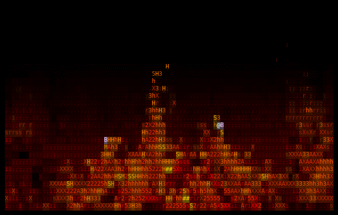

# Oh My Zsh Shellsaver adapter

This directory contains a thin Zsh launcher for the canonical `firec`
animation. It does not contain a second renderer: `fireplace.zsh` resolves the
project executable and replaces itself with `fire --shellsaver`.

## Boundary

The C application remains the only source of truth for frames, scaling,
color, timing, input handling, resize handling, and terminal restoration.
Shellsaver mode:

- renders the same embedded, video-derived fireplace as the standalone app;
- uses the entire terminal and exits on any key;
- reads no CPU, RAM, temperature, or clock data;
- accepts an optional `--seconds N` timeout; and
- restores the cursor, terminal attributes, and alternate screen on exit.

This boundary deliberately avoids translating the animation into procedural
Zsh art. The launcher adds no per-frame processes or rendering overhead.

## Local validation

```sh
make
FIREC_BIN=$PWD/fire zsh contrib/oh-my-zsh/fireplace.zsh --seconds 30
make test-omz
```

The executable is resolved in this order: `FIREC_BIN`, the repository-local
`fire` binary, then an installed `firec` or `fire` command. `FIREC_BIN` is the
unambiguous integration contract and is recommended for packaging.



## Upstream integration status

Oh My Zsh Shellsavers currently has built-in scenes but no stable external
scene-provider interface. The launcher is therefore the compatibility
boundary and a concrete proposal for an external provider contract. An
upstream integration would need to dispatch to this executable before the
current in-process renderer takes ownership of the terminal.

## License boundary

The launcher is MIT-licensed. The embedded fireplace frames remain adapted
from the CC BY 3.0 source documented in
[`FIREPLACE_SOURCE.md`](../../FIREPLACE_SOURCE.md); wrapping the executable in
Zsh does not change that license.

[shellsavers]: https://github.com/ohmyzsh/ohmyzsh/pull/14167
